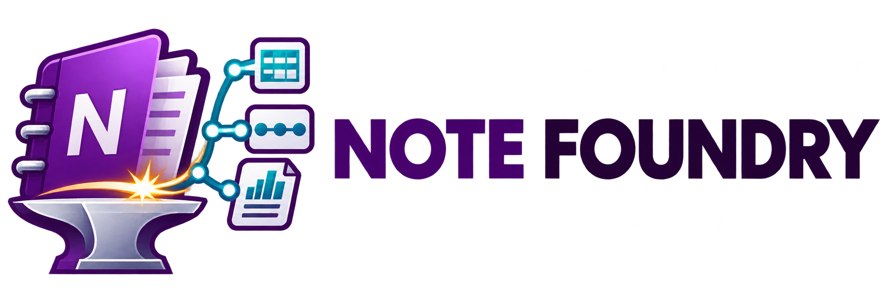
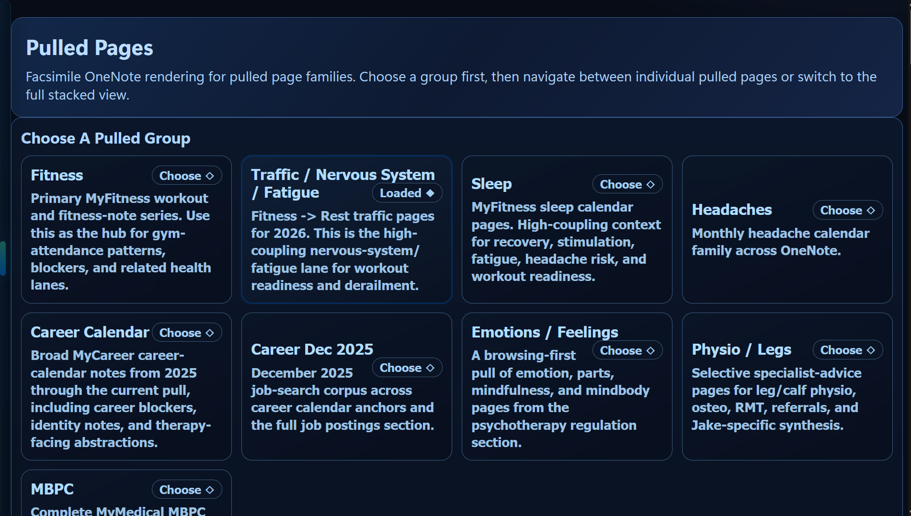
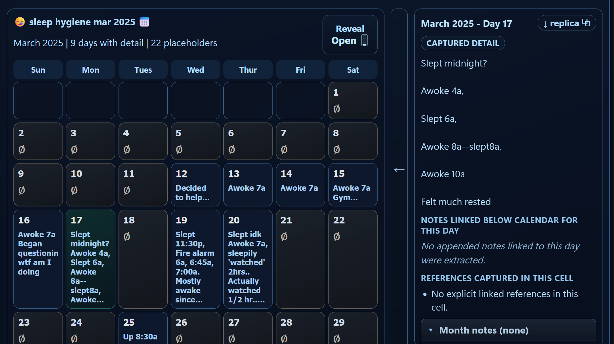
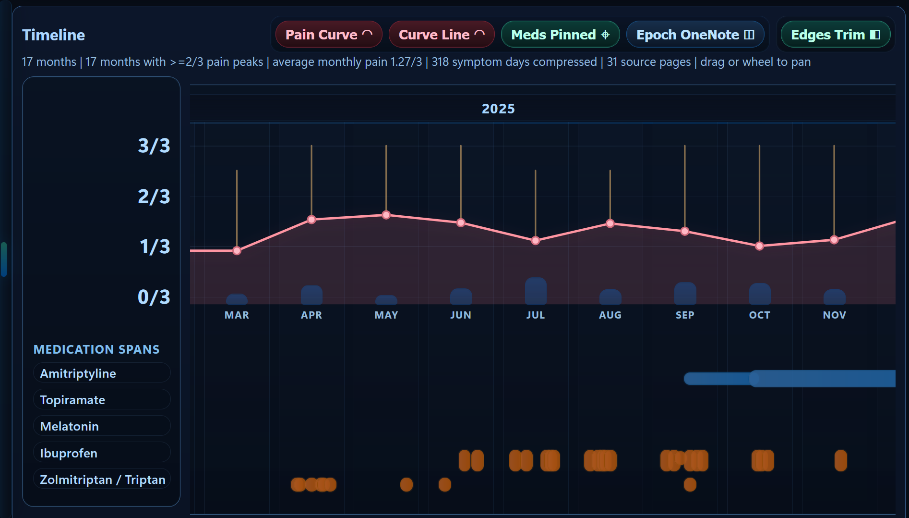
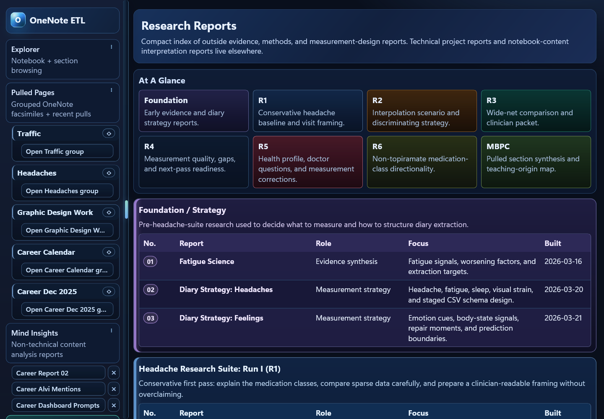
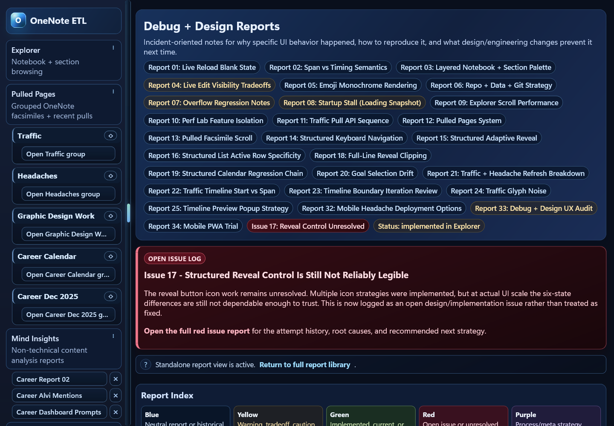
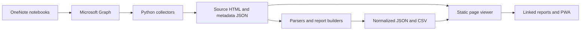

<picture>
  <source media="(prefers-color-scheme: dark)" srcset="docs/assets/brand/note-foundry-badge-dark.png">
  <source media="(prefers-color-scheme: light)" srcset="docs/assets/brand/note-foundry-badge-light.png">
  
</picture>

# Note Foundry

A local-first extraction, normalization, and inspection workbench for Microsoft OneNote.

Note Foundry uses delegated Microsoft Graph access to discover and collect preconfigured notebook and page families, preserve their source structure, derive analysis-friendly datasets, and present the results in a static dashboard. The project combines ETL scripts, a facsimile/structured page viewer, interactive timelines, linked report libraries, and an installable mobile web-app shell.

> [!NOTE]
> The public GitHub repository is currently a documentation-only project showcase. The implementation and real datasets remain local while their publication boundary is reviewed.

> [!IMPORTANT]
> This repository is built around a real personal OneNote archive. Some tracked datasets and generated reports contain private source material. This README stays mostly at the category and system-design level; a few screenshots contain short, selectively reviewed examples to make the interface understandable. That does **not** make the complete repository safe to publish. Review `docs/data/`, generated reports, media files, source URLs, identifiers, and Git history before making a remote public.

## Interface Tour

### Page-family workspaces



The main interface organizes selected OneNote material into page families rather than flattening an entire archive. Each family can retain its own navigation, source context, viewing modes, and linked reports while sharing the same extraction and dashboard foundation.

> [!NOTE]
> These groups are currently defined before they reach the dashboard. The application can browse an existing pulled group, but it does not yet provide an end-user interface for browsing the complete OneNote hierarchy, selecting pages, previewing membership rules, or creating and refreshing a new group. Current pulls are deterministic Graph/Python workflows whose definitions were developed with substantial assisted analysis; there is no runtime AI dependency.

### Structured source browsing



Source-shaped views preserve useful structures such as calendars and page hierarchies. A selected cell or page can open a focused detail panel and link back to the corresponding source replica, allowing quick scanning without discarding provenance.

### Specialized analytical modules



Beyond the shared browser, Note Foundry supports purpose-built analytical modules for selected page families. This example converts recurring records into a longitudinal curve with intervention spans, compressed event markers, time-window controls, and source-page coverage statistics. These modules are configured research workflows, not assumptions imposed on every notebook.

### Engineering and research memory

| Research library | Debug and design reports |
| --- | --- |
|  |  |

Report libraries keep interpretation, methods, incidents, and interface decisions linked to the source-facing application. Run colors make related research outputs easy to distinguish, while status-oriented technical reports retain implementation history and unresolved work.

The screenshots were selected to show both reusable platform capabilities and narrowly configured analytical work without publishing full source pages. They currently retain the earlier internal working label, **OneNote ETL**, while the application-wide visual rebrand is completed separately.

## What It Does



The durable center of the project is a controlled evidence pipeline:

1. Authenticate to Microsoft Graph with a local MSAL token cache.
2. Inventory notebooks and sections or search for a targeted page family.
3. Pull page metadata and OneNote-generated HTML while recording progress.
4. Normalize selected material into timelines, day-level metrics, cross-reference indexes, and report inputs.
5. Inspect the source and derived views locally in a browser.
6. Build linked technical, research, and subject-oriented reports without modifying the source notebooks.

## Features

### Microsoft Graph extraction

- Delegated Entra/MSAL authentication using `Notes.Read` and `User.Read`.
- Notebook, section-group, section, and page discovery with Graph pagination.
- Reusable keyword-scored page-family search plus narrower preset collectors.
- Request pacing, `429`/transient-error retries, and continuously written progress files.
- Local token caching under the ignored `.local/` directory.
- Optional split-repository layout for keeping infrastructure separate from larger data snapshots.

### Source-preserving page browser

- Grouped page-family navigation rather than a single flat export.
- Multiple facsimile modes ranging from source-faithful to progressively simplified flow layouts.
- A structured view that trades exact page positioning for faster scanning and comparison.
- Hierarchy-preserving navigation for page/subpage collections.
- Source links, page metadata, group-specific context, and linked analysis reports.
- Persistent sidebar order, collapsed state, recent-page shortcuts, and per-view preferences.

### Timelines and derived views

- Calendar-aware event extraction from loosely structured OneNote pages.
- Draggable and wheel-pannable timelines with preview dialogs and source jumps.
- Grouping, nesting, density, edge, tint, and time-label controls.
- Specialized visual layers for selected datasets, including span bars, severity overviews, and multi-epoch comparisons.
- JSON/CSV exports designed so downstream dashboards do not need to reproduce parsing logic.

### Specialized analytical modules

- Purpose-built views layered on top of the shared extraction, provenance, and navigation system.
- Domain-specific transformations such as longitudinal curves, intervention spans, calendar/detail workspaces, and hierarchy-preserving reading views.
- Explicit scoping by page family so specialized interpretations do not silently become global data assumptions.
- Reusable links back to source replicas and supporting reports for auditability.

### Proposed collection builder

The next major platform capability is a local collection-authoring workspace rather than another hard-coded page family:

- Browse a searchable notebook, section-group, section, and page tree.
- Stage explicit pages, branches, whole sections, date ranges, or pasted OneNote links.
- Apply title/context filters, exclusions, bounded link expansion, ordering, and hierarchy rules.
- Preview every proposed page with a human-readable inclusion reason before downloading content.
- Save a declarative collection manifest and run it through a loopback-only Graph job service.
- Review additions and removals before replacing an existing dataset.

This is a proposed architecture, not a current feature. The existing static server is read-only, so safe collection authoring also requires a small local control service that keeps Graph credentials and filesystem writes out of the browser.

### Report libraries

- **Research reports:** evidence, methods, measurement design, and iterative analysis runs.
- **Mind/subject reports:** cross-page synthesis over selected note families.
- **Project reports:** architecture, project drift, repository state, and handoff/context practices.
- **Debug + design reports:** incident histories, performance investigations, UI decisions, unresolved issues, and implementation status.
- Bidirectional links between reports and the pulled source-page groups they discuss.

### Desktop and mobile operation

- Dependency-free Node static server for the `docs/` application.
- Windows `.cmd` and PowerShell launchers with start, restart, stop, and status actions.
- Firefox desktop launch by default on port `5555`.
- Responsive sidebar, compact mobile layout, touch-scrollable dense controls, and backdrop-close behavior.
- Web app manifest and service worker for a whole-interface PWA trial.
- Android ADB reverse/deployment helpers that avoid depending on a public hosting service.

## Representative Data Domains

The current implementation has been exercised against several kinds of personal knowledge material:

- recurring calendar-style logs;
- fitness, recovery, mobility, and symptom records;
- work, career, and project notes;
- emotion/reflection collections;
- practitioner or course notes with nested page structure;
- technical design history and external research summaries.

These are examples of the pipeline's range, not a fixed schema. Some collectors are deliberately narrow and encode notebook names, section identifiers, or domain-specific parsing rules.

## Quick Start

### Prerequisites

- Python 3.11 or newer
- Node.js 18 or newer
- A Microsoft Entra app registration configured as a public client
- Delegated Microsoft Graph permissions: `Notes.Read` and `User.Read`
- Firefox for the supplied desktop launcher (optional if using another browser manually)
- Windows PowerShell for the convenience launch/deployment scripts

The static dashboard itself is plain HTML, CSS, and JavaScript and can be served on other operating systems with Node.

### 1. Install Python dependencies

```powershell
python -m pip install -r .\scripts\requirements.txt
```

### 2. Configure Graph authentication

In the Entra app registration:

1. Add **Mobile and desktop applications** as a platform.
2. Add the `http://localhost` redirect URI.
3. Enable public client flows.
4. Grant delegated `Notes.Read` and `User.Read` permissions.

Set the local environment:

```powershell
$env:ONENOTE_CLIENT_ID = "YOUR-APP-CLIENT-ID"
$env:ONENOTE_TENANT = "consumers"
$env:ONENOTE_SCOPES = "Notes.Read User.Read"
```

For organizational accounts, replace `consumers` with the appropriate tenant identifier.

### 3. Authenticate and verify access

```powershell
python .\scripts\auth_smoke_test.py
```

A successful check returns HTTP `200` for both `/me` and `/me/onenote/notebooks`. The serialized token cache is stored in `.local/msal_token_cache.json` and is ignored by Git.

### 4. Collect an inventory or page family

Create the notebook/section inventory:

```powershell
python .\scripts\collect_notebooks_sections.py
```

Run the reusable page-family search:

```powershell
python .\scripts\search_onenote_page_family.py `
  --title-keywords "project, meeting" `
  --context-keywords "work, planning" `
  --output "docs/data/project_pages.json" `
  --progress ".local/project_pages_progress.json" `
  --target-description "selected project and meeting pages" `
  --search-label "project-pages"
```

Preset collectors under `scripts/pull_*.py` cover the page families used by the current dashboard. See [scripts/README.md](scripts/README.md) for the maintained command catalog and output paths.

### 5. Run the dashboard

On Windows, double-click `launch-dashboard.cmd` or run:

```powershell
.\launch-dashboard.cmd
.\launch-dashboard.cmd Restart
.\launch-dashboard.cmd Status
.\launch-dashboard.cmd Stop
```

The paired PowerShell script accepts the same actions and adds options such as `-Port`, `-Route`, and `-NoBrowser`:

```powershell
.\launch-dashboard.ps1 Start -Port 5555
```

For a browser-neutral or cross-platform server:

```powershell
npm start
# Default: http://localhost:5185
```

No Node packages are currently required; `npm start` runs `serve.mjs` directly.

## Repository Layout

| Path | Purpose |
| --- | --- |
| `scripts/` | Graph authentication, collectors, imports, parsers, audits, and report builders |
| `docs/pages/pulled-pages.html` | Main grouped source-page browser and visualization workspace |
| `docs/assets/js/pulled-pages.js` | Dataset configuration, parsing, rendering, timelines, and interaction logic |
| `docs/assets/js/sidebar-shell.js` | Shared navigation, persisted state, responsive behavior, and PWA registration |
| `docs/pages/research-reports/` | Evidence and subject-analysis reports |
| `docs/pages/reports/` | Debug, performance, design, and implementation reports |
| `docs/pages/project-reports/` | Project intent, state, context-health, and handoff reports |
| `docs/data/` | Dashboard-facing source pulls, normalized exports, and generated artifacts |
| `docs/data/samples/` | Preferred location for small public-safe demonstration datasets |
| `.local/` | Ignored token caches, progress state, logs, and other machine-local artifacts |
| `serve.mjs` | Minimal static server with route fallback and content types |
| `launch-dashboard.*` | Firefox-oriented Windows lifecycle launchers |

## Data and Privacy Model

The intended long-term layout has two tiers:

1. **Curated samples in this repository** for stable demos, UI testing, and public documentation.
2. **Full exports in a separate private data repository or private storage** for real analysis.

`ONENOTE_ETL_DATA_DIR` can point the collector at a sibling data repository while retaining the local dashboard mirror needed during development.

Before publishing or sharing a build:

- replace full datasets with deliberately curated samples;
- inspect committed JSON, CSV, HTML, PDF, DOCX, ICS, and image artifacts;
- search for names, email addresses, Graph URLs, OneNote IDs, thread IDs, and local paths;
- audit Git history, not only the current working tree;
- verify screenshots at full resolution;
- never commit `.local/msal_token_cache.json` or application credentials;
- remember that `.gitignore` does not remove files already committed.

There is no automatic redaction layer. Publication safety is currently a deliberate review step.

## Mobile/PWA Notes

The PWA is a local-first trial of the full dashboard rather than a reduced mobile subset. It uses an off-canvas sidebar, persistent collapse state, touch-scrollable controls, and runtime caching. The service worker prioritizes the application shell and caches additional pages/data as they are used; it does not guarantee that every large dataset or report is available offline.

The Android helpers use ADB reverse so the phone can reach the computer's local server as `localhost`. LAN HTTP is useful for previewing, but service-worker installation generally requires a secure context. See `scripts/deploy-phone.ps1` and `scripts/show-phone-urls.ps1` for the current workflow.

## Current Limitations

- Several collectors are tailored to the original notebook structure and need configuration before reuse elsewhere.
- OneNote HTML is irregular; structured extraction relies on heuristics and domain-specific rules.
- Microsoft Graph can throttle broad discovery runs. The collectors pace requests and retry, but large pulls may still need to be divided or resumed later.
- The dashboard is a static local application. It has no server-side user management, authorization layer, or multi-user deployment model.
- Mobile replica/facsimile views remain horizontally dense even though the full interface is reachable.
- Offline support is shell-first, not a complete archive download.
- The project has extensive generated reports and manual validation history but no comprehensive automated end-to-end test suite.
- Health-related views summarize personal observational records. They are not medical advice, validated clinical instruments, or a substitute for source-record review.

## Further Documentation

The full local workbench also includes the following documentation. These links resolve when this README is viewed inside the complete private checkout; they are not part of the current public documentation snapshot.

- [Script catalog and workflows](scripts/README.md)
- [Data placement policy](docs/data/README.md)
- [OneNote extraction playbook](docs/onenote-extraction-playbook.html)
- [Dashboard guide](docs/pages/dashboard-guide.html)
- [Project intent and drift report](docs/pages/project-reports/01-project-intent-and-drift.html)
- [Mobile PWA implementation report](docs/pages/reports/34-mobile-pwa-trial-implementation.html)
- [Graph throttling audit](docs/pages/reports/35-graph-throttling-refresh-audit.html)

## Project Status

This is an actively evolved personal research and engineering workbench. It is useful as a reference implementation for selective OneNote extraction and local inspection, but it is not yet packaged as a general-purpose application.

No open-source license is currently included.
